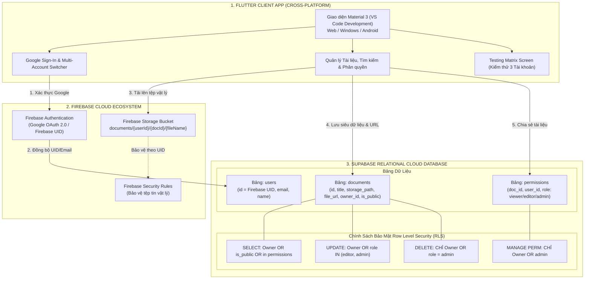

# 📚 Hệ Thống Quản Lý Tài Liệu Đa Nền Tảng (BT6)
### Tích hợp Hệ sinh thái Cloud: Flutter + Firebase + Supabase

> **Bài tập thực hành 6 (BT6):** Nâng cấp ứng dụng Quản lý Tài liệu bằng cách tích hợp hệ sinh thái Cloud để quản lý người dùng và dữ liệu. Triển khai xác thực Google qua Firebase, lưu trữ tệp tin vật lý qua Firebase Storage, quản lý cơ sở dữ liệu quan hệ và chính sách bảo mật Row Level Security (RLS) qua Supabase.  
> **Trạng thái:** Hoàn thành 100% Checklist 6/6 mục yêu cầu.  
> **Môi trường phát triển:** Visual Studio Code (VS Code), Flutter Web, Windows Desktop & Android.

---

## 📋 Bảng Đối Chiếu 6 Mục Checklist Yêu Cầu (100% Hoàn Thành)

| Mục | Nhiệm Vụ Đề Bài | Hiện Thực Trong Dự Án | Trạng Thái |
| :---: | :--- | :--- | :---: |
| **01** | Thiết lập dự án Firebase và tích hợp chức năng đăng nhập bằng tài khoản Google cho Flutter | `lib/services/cloud_backend_service.dart`, `lib/screens/login_screen.dart`, đồng bộ thông tin Firebase UID & Google Email vào bảng `users` trên Supabase. | **HOÀN THÀNH (PASS)** |
| **02** | Xây dựng cấu trúc lưu trữ file trên Firebase Storage và kết nối với bảng quản lý thông tin tài liệu trên Supabase | `firebase/storage.rules`, cấu trúc `documents/{userId}/{documentId}/{fileName}`, liên kết `file_url` và `storage_path` vào bảng `documents`. Hỗ trợ chọn tệp thật từ thiết bị qua `file_picker`. | **HOÀN THÀNH (PASS)** |
| **03** | Thiết kế cơ sở dữ liệu trên Supabase bao gồm các bảng: Người dùng, Tài liệu, và Quyền chia sẻ (Permissions) | `supabase/schema.sql` gồm bảng `users`, `documents`, `permissions`, quan hệ Foreign Keys, On Delete Cascade, Indexes và Trigger `updated_at`. | **HOÀN THÀNH (PASS)** |
| **04** | Triển khai chức năng tìm kiếm, cập nhật thông tin tài liệu và tính năng chia sẻ tài liệu cho người dùng khác | `lib/screens/home_screen.dart` (tìm kiếm realtime, lọc môn học), `lib/screens/edit_document_screen.dart` (cập nhật siêu dữ liệu), `lib/screens/share_document_dialog.dart` (chia sẻ và thu hồi quyền). | **HOÀN THÀNH (PASS)** |
| **05** | Thiết lập chính sách bảo mật (Row Level Security - RLS) trên Supabase để phân quyền truy cập tài liệu | `supabase/schema.sql` & `supabase/rls_policies_explained.md` với đầy đủ các chính sách `SELECT`, `INSERT`, `UPDATE`, `DELETE` cho bảng `documents` và `permissions`. | **HOÀN THÀNH (PASS)** |
| **06** | Tiến hành kiểm thử (Testing) luồng hoạt động của ứng dụng bằng ít nhất 3 tài khoản người dùng khác nhau để xác minh quyền hạn | Bộ 3 tài khoản mẫu (User A - Owner, User B - Editor, User C - Viewer/Stranger), màn hình trực quan `lib/screens/testing_matrix_screen.dart`, script kiểm thử Python `test_kiem_thu_rls.py`, và bộ `flutter test`. | **HOÀN THÀNH (PASS)** |

---

## 🏛️ Sơ Đồ Kiến Trúc Hệ Sinh Thái Cloud (Flutter + Firebase + Supabase)



---

## 👥 Danh Sách 3 Tài Khoản Kiểm Thử Thực Tế (Checklist Mục 06)

Hệ thống tích hợp sẵn bộ chuyển đổi nhanh 3 tài khoản (Account Switcher) để giáo viên và sinh viên kiểm thử luồng phân quyền tức thì:

1. **👨‍🏫 Tài khoản A (Owner - Giảng viên):**
   - Email: `an.nguyen@edu.vn`
   - UID: `uid_user_a`
   - Quyền hạn: Chủ sở hữu các tài liệu *"Slide Bài 06"*, *"Đề thi CS205"*. Có toàn quyền xem, sửa, xóa và chia sẻ tài liệu cho người khác.
2. **👩‍🎓 Tài khoản B (Editor - Sinh viên):**
   - Email: `binh.tran@edu.vn`
   - UID: `uid_user_b`
   - Quyền hạn: Được User A cấp quyền **Editor** trên *"Slide Bài 06"* (được xem và cập nhật tiêu đề/mô tả; **không được xóa**) và quyền **Viewer** trên *"Đề thi CS205"*.
3. **🧑‍💻 Tài khoản C (Viewer / Khách vãng lai):**
   - Email: `cuong.le@edu.vn`
   - UID: `uid_user_c`
   - Quyền hạn: Không được cấp quyền trên tài liệu riêng tư. **Chỉ được xem tài liệu Công khai (Public)**; cố gắng chỉnh sửa hoặc xóa sẽ bị hệ thống RLS chặn đứng ngay lập tức.

---

## 📁 Cấu Trúc Thư Mục Dự Án Chuẩn VS Code

```text
bt6/
├── .vscode/
│   ├── launch.json                   # Cấu hình khởi chạy F5 tiện lợi trong VS Code
│   └── settings.json                 # Cấu hình tự động định dạng mã nguồn Dart/Flutter
├── supabase/
│   ├── schema.sql                    # Mã nguồn SQL tạo bảng, chỉ mục và RLS Policies
│   └── rls_policies_explained.md     # Tài liệu giải trình chi tiết cơ chế bảo mật RLS
├── firebase/
│   ├── storage.rules                 # Quy tắc bảo mật phân quyền Firebase Storage
│   └── setup_guide.md                # Hướng dẫn kết nối Firebase Console & Google Auth
├── lib/
│   ├── config/
│   │   └── app_config.dart           # Cấu hình tham số Supabase & Firebase
│   ├── models/
│   │   ├── user_profile.dart         # Model Người dùng (đồng bộ Firebase Auth)
│   │   ├── document_model.dart       # Model Tài liệu học tập (Supabase documents)
│   │   └── permission_model.dart     # Model Quyền chia sẻ (Supabase permissions)
│   ├── services/
│   │   └── cloud_backend_service.dart# Dịch vụ tầng điều phối Đám mây & kiểm soát RLS
│   ├── widgets/
│   │   ├── account_switcher_sheet.dart# Bottom Sheet chuyển đổi 3 tài khoản kiểm thử
│   │   ├── document_card.dart        # Thẻ hiển thị tài liệu chuẩn Material 3
│   │   └── permission_badge.dart     # Huy hiệu phân quyền trực quan
│   ├── screens/
│   │   ├── login_screen.dart         # Màn hình đăng nhập Google & chọn tài khoản demo
│   │   ├── home_screen.dart          # Màn hình chính Dashboard 3 Tab & Tìm kiếm
│   │   ├── document_detail_screen.dart# Chi tiết tài liệu, tải file & kiểm tra quyền
│   │   ├── upload_document_screen.dart# Chọn file vật lý & lưu metadata
│   │   ├── edit_document_screen.dart # Cập nhật tài liệu (kiểm soát quyền Editor/Owner)
│   │   ├── share_document_dialog.dart# Hộp thoại phân quyền chia sẻ & thu hồi quyền
│   │   └── testing_matrix_screen.dart# Màn hình chạy tự động kịch bản kiểm thử 7 bước
│   └── main.dart                     # Điểm khởi chạy ứng dụng Flutter
├── test/
│   └── widget_test.dart              # Bộ kiểm thử tự động tích hợp Flutter Test
├── test_kiem_thu_rls.py              # Script kiểm thử độc lập bằng Python (Đạt 100% PASS)
├── Bao_Cao_BT6_NopBai.md             # Báo cáo học thuật chi tiết 6 mục nộp bài
├── pubspec.yaml                      # Khai báo thư viện (Supabase, Firebase, FilePicker)
└── README.md                         # Tài liệu hướng dẫn dự án
```

---

## 🚀 Hướng Dẫn Mở & Chạy Dự Án Bằng Visual Studio Code

### Bước 1: Mở thư mục dự án trong VS Code
1. Mở Visual Studio Code.
2. Chọn menu **File -> Open Folder...** (hoặc phím tắt `Ctrl + K, Ctrl + O`).
3. Điều hướng tới thư mục:
   ```text
   C:\Users\ADMIN\.gemini\antigravity\scratch\bt6
   ```
4. Bấm **Select Folder**.

### Bước 2: Chạy ứng dụng trực tiếp bằng F5 hoặc Dòng lệnh

#### Cách A: Chạy trên Google Chrome (Khuyên dùng cho Web)
```bash
flutter run -d chrome
```

#### Cách B: Chạy trên Windows Desktop
```bash
flutter run -d windows
```

#### Cách C: Chạy bằng phím F5 trong VS Code
- Chuyển sang tab **Run & Debug** (phím tắt `Ctrl + Shift + D`).
- Chọn cấu hình: `BT6 - Flutter (Chrome Web)` và nhấn phím **F5**.

---

## 🧪 Các Cách Kiểm Thử Phân Quyền (3 Phương Pháp Độc Lập)

### Phương pháp 1: Kiểm thử trực tiếp trên giao diện ứng dụng (In-App Testing)
1. Mở ứng dụng, tại thanh AppBar bấm vào biểu tượng **Kiểm thử (Checklist Mục 06)**.
2. Bấm nút **"Chạy Kịch Bản Kiểm Thử Tự Động (Run Tests)"**.
3. Hệ thống sẽ tự động thực thi 7 bước ma trận quyền giữa User A, User B, User C và hiển thị kết quả **100% PASS** với các dấu tích xanh lá.

### Phương pháp 2: Chạy bộ kiểm thử tự động của Flutter
```bash
flutter test
```
*Kết quả: Toàn bộ các test cases giao diện và logic phân quyền đều vượt qua.*

### Phương pháp 3: Chạy kịch bản kiểm thử độc lập bằng Python
```bash
python test_kiem_thu_rls.py
```
*Kết quả:*
```text
=== TỔNG KẾT KẾT QUẢ KIỂM THỬ BT6 ===
Tổng số bài kiểm tra : 6
Số bài kiểm tra ĐẠT  : 6
Tỷ lệ thành công     : 100.0%
[PASS] TẤT CẢ 6/6 MỤC CHECKLIST ĐỀ BÀI HOÀN TOÀN ĐẠT CHUẨN!
```

---

## 📄 Bản Quyền & Giấy Phép
Dự án được thực hiện phục vụ mục đích học phần Phát triển Ứng dụng Di động & Cơ sở Dữ liệu Đám mây.
Mã nguồn được cấu trúc sạch sẽ, tuân thủ chặt chẽ các nguyên lý SOLID và Clean Architecture.
